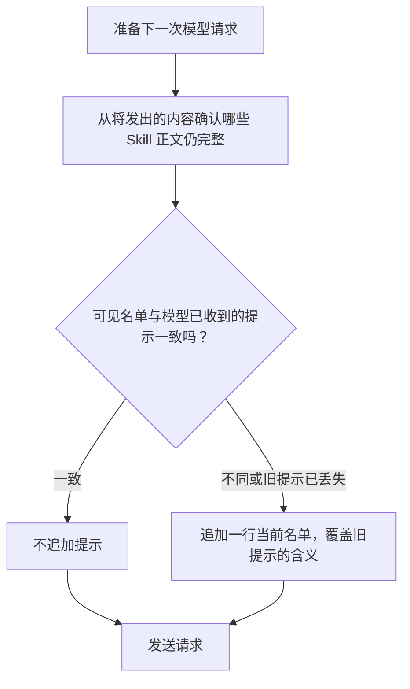

# DSH Skill 上下文验证地图

从仓库根目录运行 [SKILL.md](../SKILL.md) 的 Doctor。每个入口用全新的合成会话；请求中出现名字、工具轨迹或目录描述，都不等于正文可见。

| 用户入口 | 应在模型请求里看到什么 |
|---|---|
| [普通提问](catalog.md) | 第一请求有目录，无该 Skill 正文 |
| [请模型使用 skill 工具](load.md) | 第一请求无正文；工具成功后，第二请求有完整正文 |
| [直接输入 /sample-context](slash.md) | 第一请求已有完整正文，无需工具调用 |

验证提醒的后续请求：同一工具再次加载用 `verify.py repeat`；已发名单后裁剪正文用 `verify.py prune`，整段压缩用 `verify.py compact`。这三条路径都检查模型请求、CLI 工具结果与召回侧输入。

## Pi：按正文可见性变化提醒

初始名单为空且没有旧提示时静默。如果仍有旧提示但已无正文，明确清空。只识别 Skill 来源的完整指令，不把模型引用、目录或工具的内部轨迹当正文。优先利用会话已有的消息来源及压缩边界，不在每步重新扫描文件或对整个提示做字符串搜索；验证脚本的合成标志只用于观测。嵌套工具的结果无法可靠归因时，宁可不报“已加载”。
