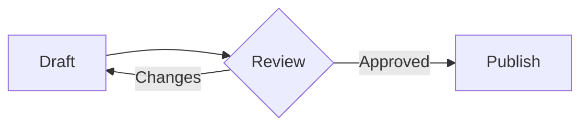

# Diagram preview for DSH

In DSH Web chat, a labeled Markdown fence becomes a diagram once the reply finishes streaming. Each diagram has its own **Preview** and **Code** buttons. Code shows the original DSH code block, including its copy action. Invalid diagrams show an error and keep the source. The plugin never edits the message.

Choose Small, Medium or Large for each inline diagram. Click the image (or focus it and press Enter) to open a larger preview fitted to the window. Zoom up to 400% and scroll to inspect details. Press Escape or Close to return to the same diagram.

| Fence language | Content |
| --- | --- |
| `mermaid`, `mmd` | Mermaid diagrams, including flowcharts, sequence diagrams, ER diagrams and Gantt charts |
| `dot`, `graphviz` | Graphviz DOT graphs |
| `echarts` | An ECharts option as JSON, not a JavaScript snippet |
| `svg` | A standalone SVG image with its XML namespace |

Example message:

~~~~markdown

~~~~

The rendering libraries ship with the plugin and load on demand. Diagrams render locally as images; links, scripts, interactive chart controls and external resources are not supported. Unlabeled fences, plain JSON, math, diffs and other languages keep their existing behavior.

Install the local package from the repository root:

```sh
dsh plugin --profile web add "link:$PWD/packages/diagram-preview"
```

The three `lib/client.<engine>.js` files are generated from pinned upstream browser distributions. To regenerate them after changing versions, run `pnpm --filter dsh-diagram-preview build` from the workspace. Licenses are in `lib/licenses/`.
